 

 

## ✦ about

i like turning messy datasets into things that make sense, whether that's a music knowledge graph or the redshift of a galaxy a few billion light-years away. most of my projects live somewhere between **data science**, **machine learning**, and **explainable retrieval**.

 

## 🛰️ missions

| | |
|---|---|
| **[reminisGraph](https://github.com/kalilank/reminisGraph)** explainable music discovery that compares graph, vector, and hybrid retrieval over a music knowledge graph. | **[Redshifted](https://github.com/kalilank/Redshifted)** celestial object classification and galaxy redshift prediction using SDSS data. |
| **[serviceops-data-pipeline](https://github.com/kalilank/serviceops-data-pipeline)** end-to-end data engineering pipeline for IT incident and SLA analytics. | **[bank-transactions-postgres-schema](https://github.com/kalilank/bank-transactions-postgres-schema)** PostgreSQL schema design and query performance benchmarking on a banking transaction dataset. |

 

## 🔭 toolkit

  
  
  
  
  
  
  

 

## 📡 telemetry

  

 

## ☄️ say hi

<!-- ganti YOUR_LINKEDIN dengan username LinkedIn kamu -->

 

see ya!

